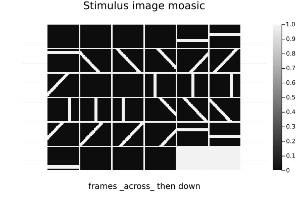
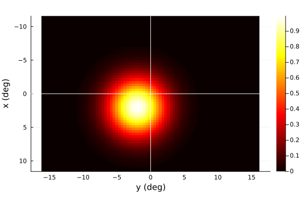
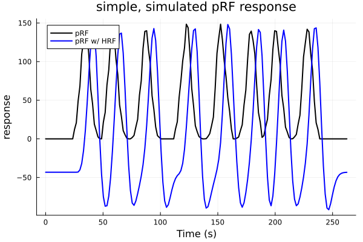
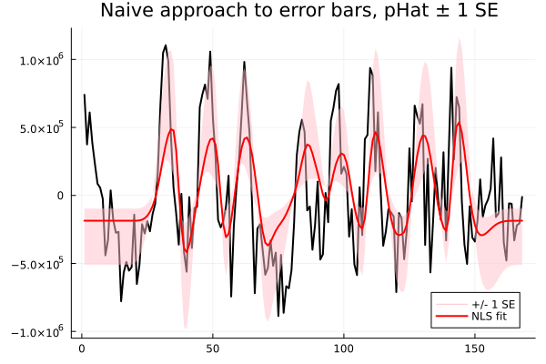
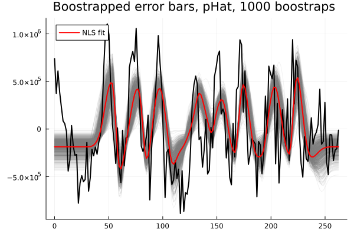
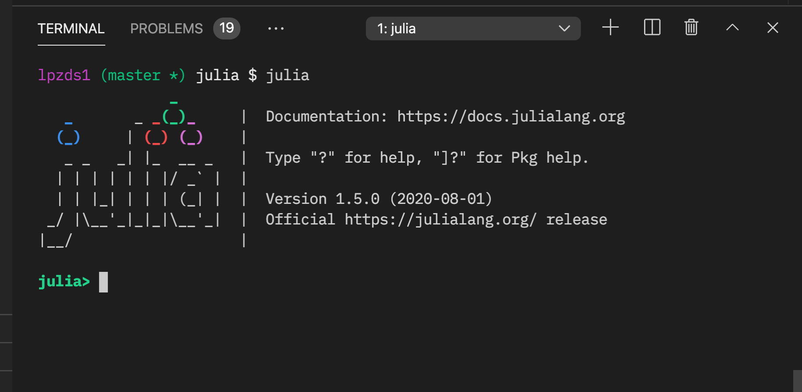

## `julia` version of pRF code

### Gallery

<center>







</center>

### What you'll need

- download + install `julia` (the original version was made with v"1.5.0", but code tested with v"1.11.7" and information about environment added more recently) - as of 2025, `juliaup` provides a robust way to stay up to date. [Instlallation instructions](https://julialang.org/install/)

- add packages to fullfil dependencies by activating the environment in REPL (which could be inside VSCode or standalone)




```julia
] # enter package mode
activate .  # activate current dir as environment
instantiate  # install packages listed in Project.toml
```

Then you can try running the code (!NB data files are in parent dir for now (where matlab code lives)).

```julia
include("pRF_nls.jl")
# and hopefully figures will pop up
# if not, try to force the display
pboot_  # figure handle
# and
hm_
```

- @todo: a `Pluto` notebook version would be nice
- @todo: quick video of running `julia` code in VS code using extension.
- @todo: add bit about command line
- @todo: use of `BenchmarkTools.jl` for getting good timing info

